# Comimo

**Talk about your day for a minute. Get it back as a comic, starring the people in your life.**

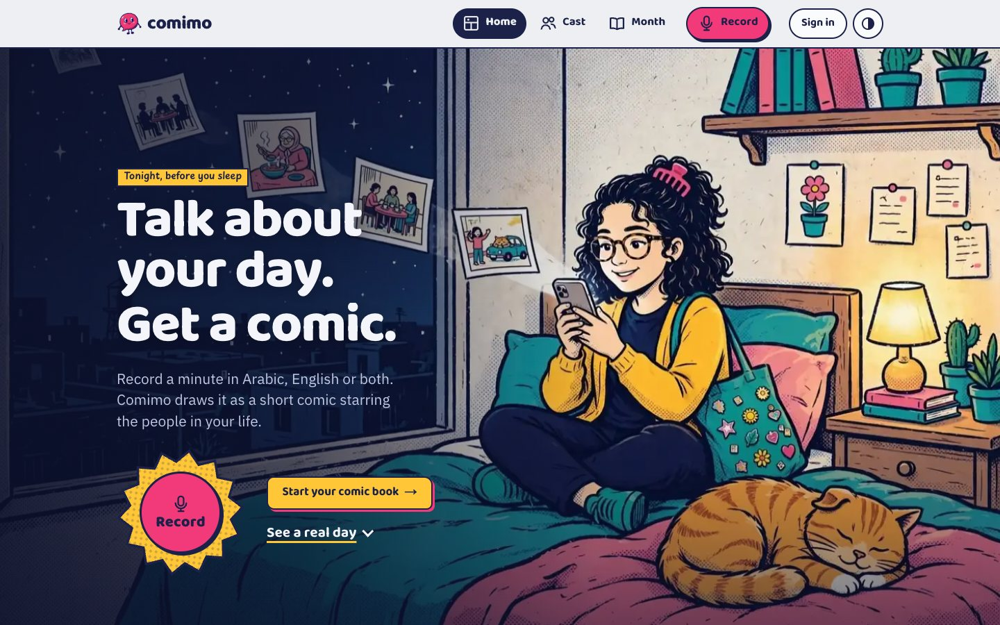

Comimo is a comic diary for people who would never keep one. You record a voice note, or type a few lines, in Arabic, English or both in one sentence. Comimo picks the moments worth drawing, writes the panels and the dialogue, and draws them with your own cast: you, your friends, your family, even the cat, each one looking like themselves in every panel. Your comics fill diaries, the good moments of your week are gathered for you, and every month is bound into a magazine.

Built from scratch for the **Meta Global AI Developer Hackathon** (October 27 to November 4, 2026), track **Build for Your World**. Every line of code in this repository was written during the hackathon.

| | |
|---|---|
| **Live app** | **https://comimo.vercel.app** (sign up with any email; real Meta models) |
| **Models** | Muse Voice Transcribe, Muse Spark (`muse-spark-1.3`), Muse Image (`muse-image-1.0`), SAM 3.1 |
| **Stack** | Next.js 16, React 19, TypeScript, Upstash Redis, Vercel Blob |
| **Try it offline** | `npm install && cp .env.example .env.local && npm run dev` (practice mode, no key needed) |

## Why

Most people never write a diary, but everyone tells someone about their day. Comimo keeps that telling. Talking for a minute is easy, and getting your friends back as a comic is the reason to come back tomorrow. A month later you have a magazine of your own life.

## The flow: one voice note to one comic

| 1. Talk | 2. Muse Spark writes it | 3. Muse Image draws it | 4. SAM 3.1 checks every face |
|---|---|---|---|
| 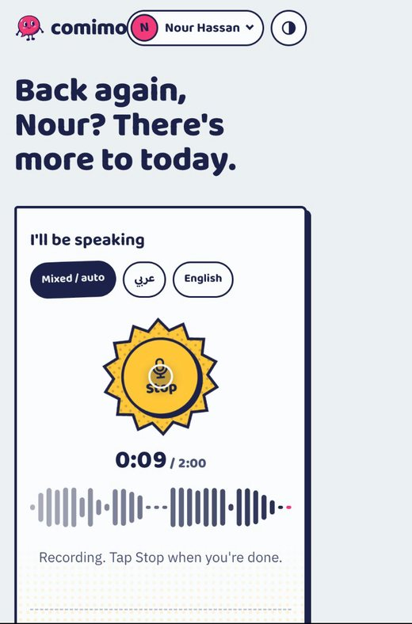 | 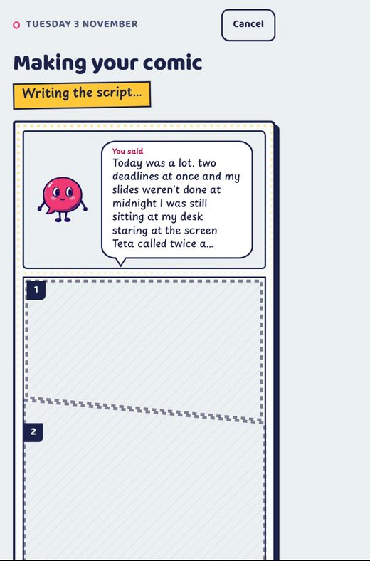 | 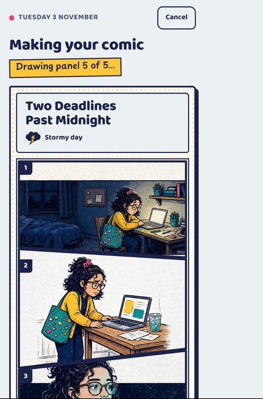 | 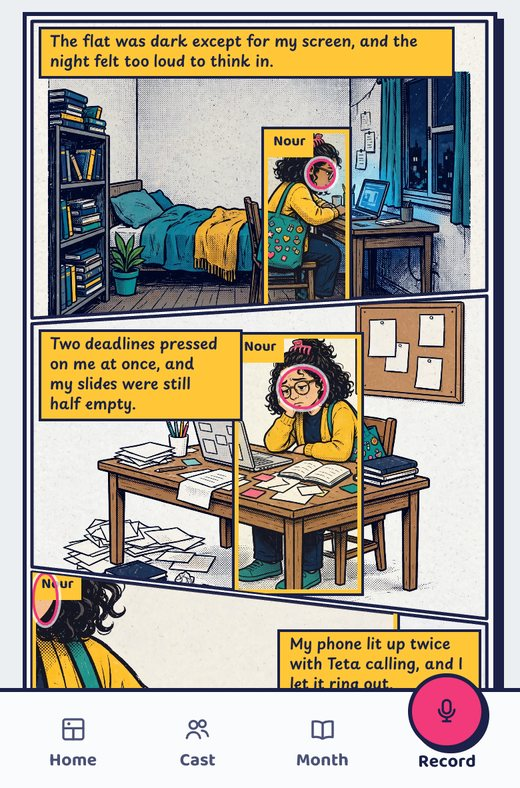 |
| Arabic, English or mixed. Up to two minutes, or type it. | Picks the moments, lays out the panels, writes captions, dialogue and reaction lines. | Every panel is drawn from the cast's reference sheets, so people stay themselves. | Anyone who drifted from their sheet is redrawn. The stamp shows what changed. |

These frames are from a real run with the real models (the progress screen shows each step as it happens).

### What happens inside

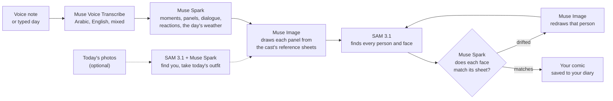

The pipeline runs step by step from the browser (`src/lib/pipeline.ts`), so every step shows on screen while it runs, a step can be retried on its own, and the finished comic keeps a record of what each step cost.

### Your journey through the app

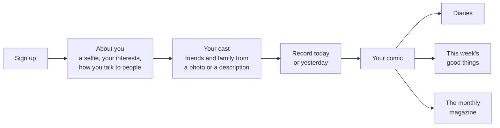

## Screens

**A finished comic.** People who were there get short reaction lines in their own voice, but a reaction never adds an event or a fact you didn't say. The pink stamp marks a face SAM 3.1 spotted drifting and Muse Image redrew; tap it to see the panel before the fix.

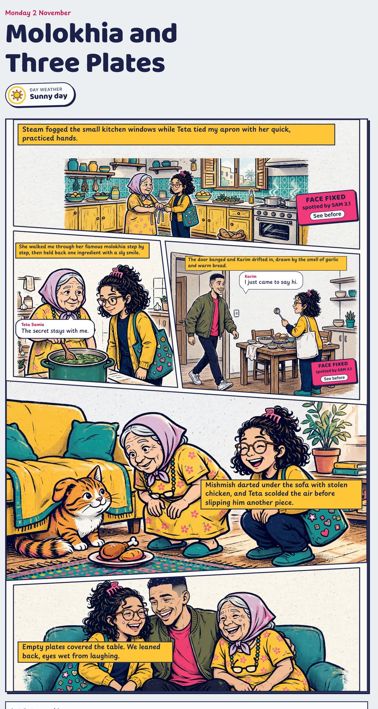

**Show what SAM 3.1 saw.** One switch on any comic draws the boxes SAM 3.1 found over every panel, with each person's name. "How it was made" lists who was redrawn and what the comic cost.

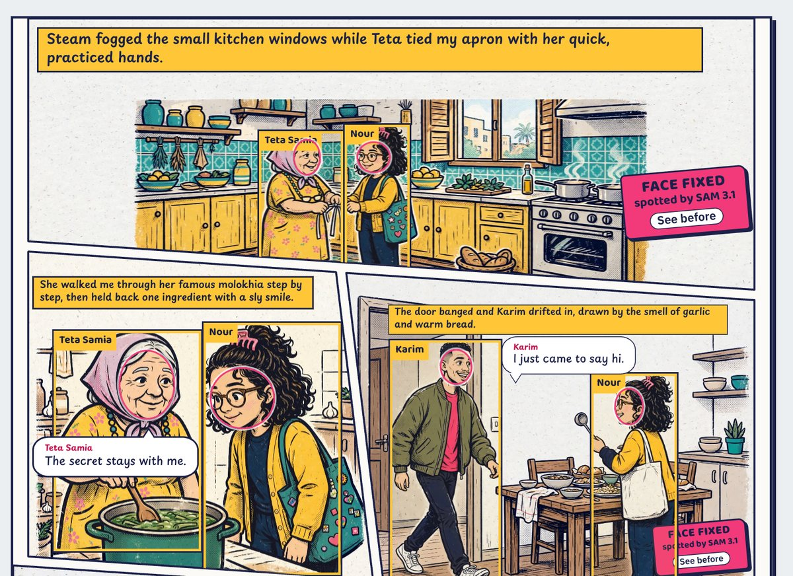

| Your cast | Record |
|---|---|
| 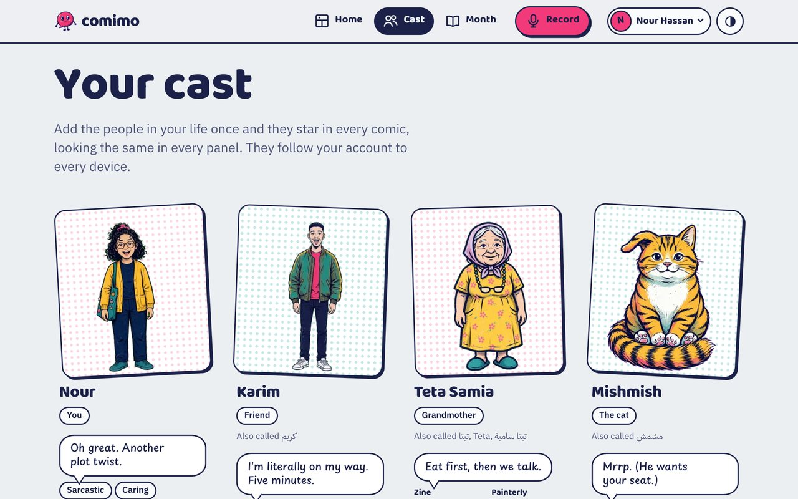 | 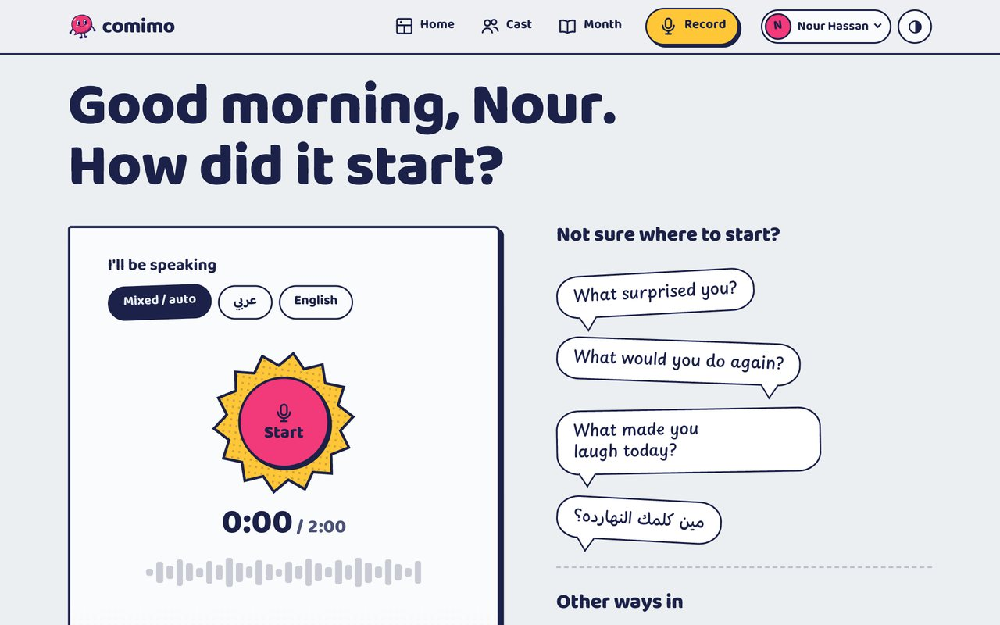 |
| Everyone is drawn once from a photo or a description. Clothes change from a photo or a sentence, and today's photos dress you the way you really were. | Pick a language or let Comimo detect it. Missed a day? Tell it the next morning and pick Yesterday. |

| Home and this week's good things | The monthly magazine |
|---|---|
| 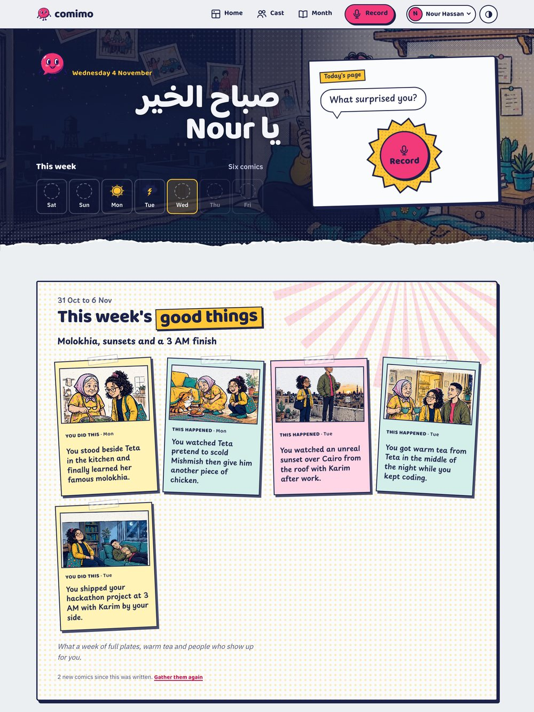 | 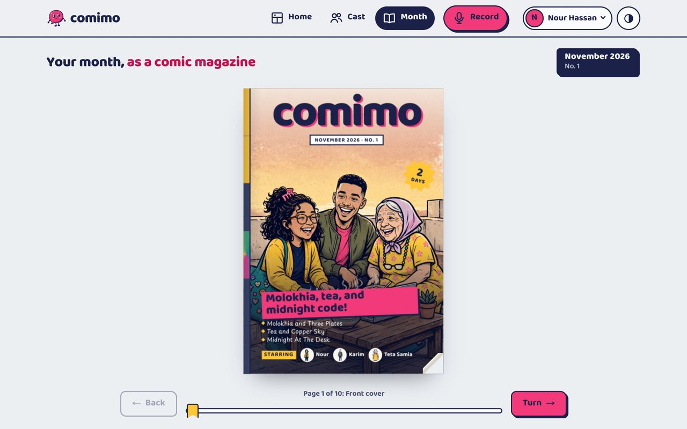 |
| One button gathers the good moments of your week, each pinned to the panel it happened in. | Each month becomes an issue with a drawn cover, the month's weather on one page, readable in the browser or printed. |

**Heavy days.** When a day sounds like a lot, a short check-in card follows the comic: a few gentle questions, no scores, no advice. A note about hurting yourself is never turned into a comic.

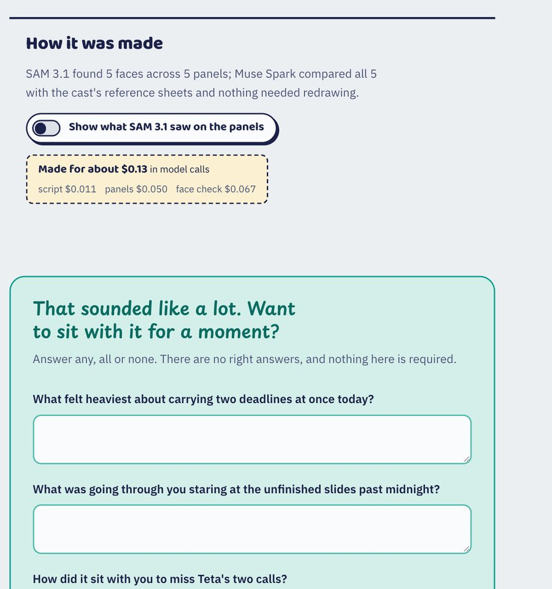

## What it does

- **A comic from a voice note.** Record up to two minutes, or type it. Egyptian Arabic, English and mixed sentences all work, and the comic keeps the language you spoke.
- **Your cast, drawn once.** Add someone from a photo or a description. Comimo makes a reference sheet for them, and every comic draws them from that sheet.
- **You're in it.** "About you" asks for a photo, your interests and how you deal with people (sarcastic, quiet, loud, caring, and so on). That decides how you look and how you talk in your comics.
- **Clothes that change.** Change your clothes from a photo or by describing them. Attach today's photos before making a comic and Comimo finds you in them and dresses you the way you were that day.
- **Faces that stay the same.** SAM 3.1 finds every person in every panel, Muse Spark compares each face with that person's sheet, and Muse Image redraws anyone who drifted.
- **Diaries.** Every day keeps your daily comics. Make a diary for anything else ("Things I love", "Bad days", any name in any language).
- **This week's good things**, pinned to the panels they happened in.
- **Heavy days** get a gentle check-in card instead of advice or scores.
- **The monthly magazine**, with a drawn cover and the month's weather.
- **Photo albums.** Add real photos to a day and share them by link or by the QR code printed on the comic's last page.
- **What it cost.** Every comic shows what its model calls cost.

## How the Meta models are used

| Model | What it does in Comimo |
|---|---|
| **Muse Voice Transcribe** | Turns the voice note into text, Arabic and English mixed. The audio is sent once and never stored. |
| **Muse Spark** (`muse-spark-1.3`) | Reads the day and writes the comic: which moments to draw, panel layout, scenes, captions, dialogue and reaction lines, the day's weather. It also describes people from photos for their sheets, judges whether each drawn face matches its sheet, rewrites a scene gently when the image model refuses it, and writes the week's good things. |
| **Muse Image** (`muse-image-1.0`) | Draws reference sheets, outfits (as edits of the sheet, so the face stays), every panel from the cast's sheets, the cast's sprites and the magazine cover. |
| **SAM 3.1** | Finds the people in day photos to take today's clothes, and finds every person and face in every drawn panel so drifted characters can be redrawn. It also places speech bubbles away from faces. |

## What a comic costs

Measured on real runs, for a 5-panel comic:

| Step | Cost |
|---|---|
| Today's outfit from a photo (optional) | $0.026 |
| Script (Muse Spark) | $0.013 |
| Drawing 5 panels (Muse Image) | $0.050 |
| Face check (SAM 3.1 and Muse Spark) | $0.094 |
| **Total** | **$0.18** with a day photo, about **$0.16** without |

A voice note adds about $0.003. Setting up "About you" costs about $0.02, and each new outfit about $0.016. Every comic records its own cost. The server keeps a per-account ledger with no story text in it, and `scripts/costs-report.mjs` prints the totals.

## Run it locally

You need Node.js 20 or newer.

```bash
npm install
cp .env.example .env.local
npm run dev
```

Open http://localhost:3000.

**Practice mode.** With `COMIMO_MOCK=1` (the default in `.env.example`), no model is called and nothing costs anything. Every step answers with sample output, so the whole app can be clicked through offline.

**Real models.** Put your Meta Model API key in `MODEL_API_KEY` and set `COMIMO_MOCK=0`.

**Local production build.** Accounts need a trusted source for the visitor's IP. Locally, start it with:

```bash
npm run build
COMIMO_TRUSTED_IP_HEADER=x-forwarded-for npm start
```

Locally, accounts, comics and images are kept under `.data/`.

## Deploy

Comimo runs on Vercel. In production it needs:

| Variable | Purpose |
|---|---|
| `MODEL_API_KEY` | Meta Model API key. |
| `COMIMO_MOCK` | `0` for real models. |
| `NEXT_PUBLIC_SITE_URL` | The public address, used in share links and QR codes. |
| `COMIMO_GUARD_SALT` | Salt for the hashed ids sent to Meta and used in rate limits. |
| `COMIMO_MAINTENANCE_SECRET` | Bearer secret for the owner's maintenance and cost endpoints. |
| `UPSTASH_REDIS_REST_URL`, `UPSTASH_REDIS_REST_TOKEN` | Accounts, sessions, limits and each account's comic index. Vercel's Upstash integration sets `KV_REST_API_URL` and `KV_REST_API_TOKEN`, which also work. |
| `BLOB_READ_WRITE_TOKEN` | A private Vercel Blob store for comic images and album photos. |

A spending guard limits every real model call:

- Comics per account per hour: `COMIMO_COMICS_PER_HOUR`, default 5.
- A daily ceiling for everyone: `COMIMO_DAILY_COMIC_CAP` and `COMIMO_DAILY_IMAGE_CAP`.
- A kill switch: `COMIMO_PAUSE_GENERATION=1` stops every real call.

## Tests

```bash
npm test             # Vitest: 282 tests
npx tsc --noEmit     # types
npx eslint src       # lint
```

## Project layout

| Path | What's there |
|---|---|
| `src/app/` | Pages: the landing page and signed-in home at `/`, plus `record`, `day/[id]`, `cast`, `diaries`, `month`, `album`, `welcome`, `account` and `privacy`. API routes live under `src/app/api/`. |
| `src/lib/models/meta/` | The Meta model calls (transcribe, script, image, SAM, consistency, outfit, week), their prompts and the price table. |
| `src/lib/models/mock.ts` | Practice-mode answers for every call. |
| `src/lib/pipeline.ts` | The comic pipeline, run step by step from the browser. |
| `src/lib/server/` | Accounts, sessions, the KV and Blob stores, rate limits, albums and the cost ledger. |
| `src/components/` | The comic reader, the magazine, diaries, the cast and everything else on screen. |
| `src/art/` | The art manifest and the sprite player. The site art itself was drawn with Muse Image (`scripts/generate-site-art.mjs`). |

## Privacy

The privacy page (`/privacy` in the app) lists what Comimo keeps, what it throws away, and what it never does:

- Audio is never stored.
- Photos for faces and clothes are shrunk on your device, sent to Meta's models to draw you, and never saved.
- Album photos are re-encoded without location or camera data.
- There are no mood scores and no advice.

## Third-party packages

| Package | Licence | Used for |
|---|---|---|
| [qrcode](https://github.com/soldair/node-qrcode) 1.5.4 | MIT | The QR code on a comic's last page and in the magazine (drawn as SVG by Comimo). |
| [@upstash/redis](https://github.com/upstash/redis-js) 1.39.0 | MIT | Accounts, sessions, limits and each account's comic index in production. |
| [@vercel/blob](https://github.com/vercel/storage) 2.8.2 | Apache-2.0 | Private image storage in production. |
| [gsap](https://gsap.com) 3.15.0, [lenis](https://github.com/darkroomengineering/lenis) 1.3.27 | GSAP standard licence, MIT | Scroll and page motion. |
| [idb](https://github.com/jakearchibald/idb) 8.0.4 | ISC | The on-device comic book (IndexedDB). |
| [sharp](https://github.com/lovell/sharp) 0.35.5 | Apache-2.0 | Server-side image work: sizing images for SAM 3.1, cut-outs and caption placement. |
| @meta-sam/parser 0.1.0 | See its LICENSE | Reading SAM 3.1's streamed segmentation results. |
